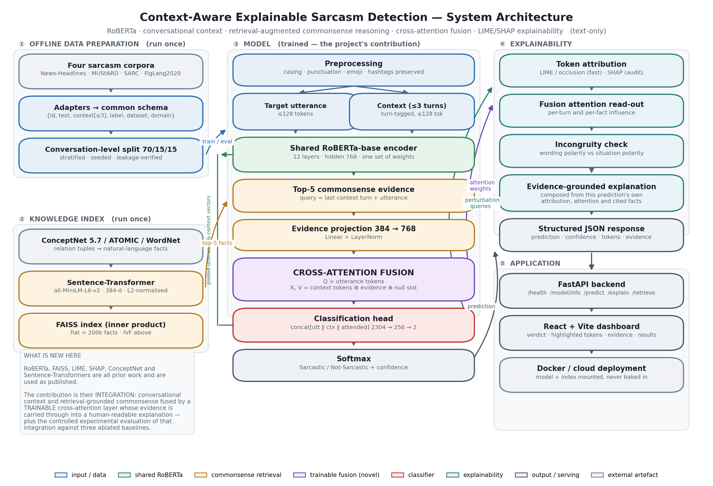
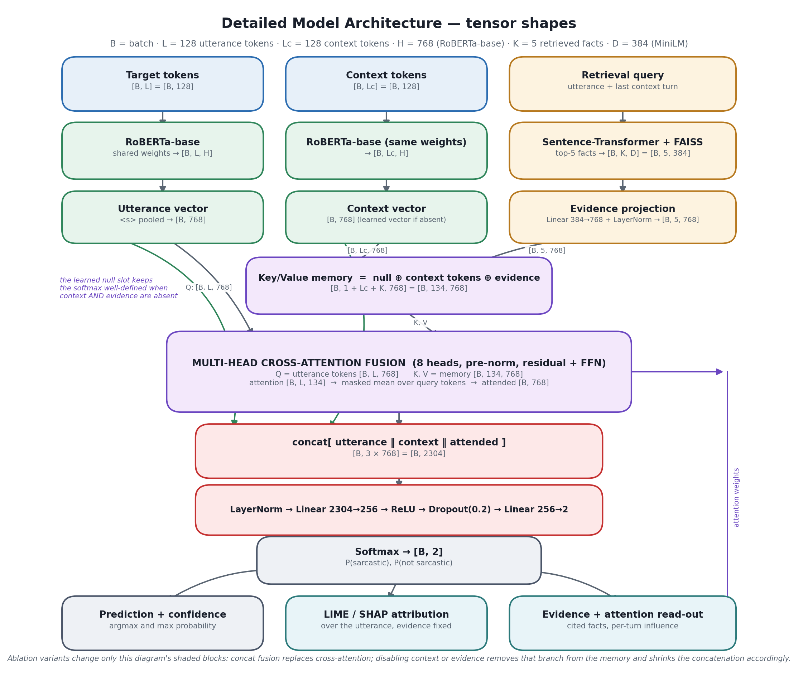
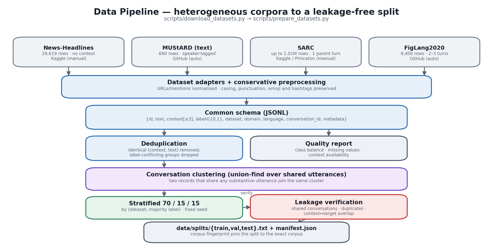

# A Context-Aware Explainable Framework for Sarcasm Detection Using RoBERTa and Retrieval-Augmented Commonsense Reasoning

A complete, reproducible research system: it acquires and normalises four sarcasm
corpora, builds an offline commonsense knowledge index, trains a RoBERTa model
that fuses conversational context and retrieved commonsense evidence through a
**trainable cross-attention layer**, explains every prediction with LIME/SHAP
plus the fusion layer's own attention, and serves the whole thing through a
FastAPI backend and a React research dashboard.

**Text only.** No audio, video or image input is accepted or used anywhere.

---

## Table of contents

1. [Problem](#1-problem)
2. [Motivation](#2-motivation)
3. [Research gap](#3-research-gap)
4. [Proposed architecture](#4-proposed-architecture)
5. [Architecture diagrams](#5-architecture-diagrams)
6. [Features](#6-features)
7. [Project structure](#7-project-structure)
8. [Installation](#8-installation)
9. [Dataset setup](#9-dataset-setup)
10. [Knowledge-base setup](#10-knowledge-base-setup)
11. [Training](#11-training)
12. [Evaluation](#12-evaluation)
13. [Ablation studies](#13-ablation-studies)
14. [Benchmarking](#14-benchmarking)
15. [Running the backend](#15-running-the-backend)
16. [Running the frontend](#16-running-the-frontend)
17. [Running the complete application](#17-running-the-complete-application)
18. [Docker deployment](#18-docker-deployment)
19. [Cloud deployment](#19-cloud-deployment)
20. [API documentation](#20-api-documentation)
21. [Explainability](#21-explainability)
22. [Testing](#22-testing)
23. [Reproducibility](#23-reproducibility)
24. [Research integrity: what is and is not claimed](#24-research-integrity-what-is-and-is-not-claimed)
25. [Limitations](#25-limitations)
26. [Future work](#26-future-work)
27. [Citations and references](#27-citations-and-references)
28. [Viva explanation](#28-viva-explanation)

---

## 1. Problem

Given a **target utterance** — a tweet, a Reddit comment, a news headline or a
conversational reply — and optionally up to **three preceding conversational
turns**, decide whether the utterance is **sarcastic** or **not sarcastic**, and
explain why.

The system returns:

| Output | Description |
|---|---|
| Prediction | `Sarcastic` / `Not Sarcastic` |
| Confidence | Probability of the predicted class |
| Influential tokens | Signed, normalised attribution per word |
| Retrieved evidence | Top-*k* commonsense facts with source, relation and similarity |
| Explanation | A human-readable paragraph composed from the above |
| Context influence | How much cross-attention each preceding turn received |
| Incongruity signal | Whether a literal-wording vs situation clash was detected |

## 2. Motivation

Sarcasm inverts literal meaning. A model that reads only the surface form of
*"Perfect timing, as always."* has no way to tell praise from mockery — the
distinction lives in the **situation** the utterance comments on. Two things
supply that situation:

* **conversational context** — what was said immediately before, and
* **commonsense knowledge** — the shared background that says a nine-day-late
  delivery is undesirable.

Systems that ignore either one systematically fail on exactly the cases that
matter. And in any application where a sarcasm judgement feeds a downstream
decision (content moderation, opinion mining, customer-feedback triage), an
unexplained binary label is not actionable: a reviewer needs to see *why*.

## 3. Research gap

The literature covers the three ingredients separately:

* **contextual modelling** — RoBERTa and context-aware transformers improve
  conversational sarcasm detection (FigLang 2020 shared task; Ghosh et al.);
* **knowledge augmentation** — commonsense knowledge helps figurative-language
  understanding (ConceptNet, COMET/ATOMIC-based systems);
* **explainability** — token attribution (LIME, SHAP) makes classifier decisions
  inspectable.

What is *not* established is their **integration**: a single trainable model in
which conversational context and retrieval-grounded commonsense are fused by a
learned attention mechanism, and in which the retrieved evidence is *carried
through* into a human-readable explanation rather than discarded after
classification.

> **This project does not claim to have invented RoBERTa, SHAP, LIME, ConceptNet,
> Sentence-Transformers or FAISS.** All of those are prior work, used as
> published. The contribution is the integration described above, the
> cross-attention fusion layer that performs it, and the controlled experimental
> evaluation of that integration against three ablated baselines.

## 4. Proposed architecture

```
                     ┌──────────────────────────────┐
  target utterance ─►│                              │─► utterance states [B,L,768]
                     │   SHARED RoBERTa-base        │
  context (≤3 turns)►│   (one set of weights)       │─► context states  [B,Lc,768]
                     └──────────────────────────────┘
                                    │
  utterance + last turn ─► Sentence-Transformer ─► FAISS ─► top-5 facts
                                    │                          │
                                    │                Linear 384→768 + LayerNorm
                                    ▼                          ▼
                     ┌─────────────────────────────────────────────────────┐
                     │   CROSS-ATTENTION FUSION                            │
                     │   Q = utterance tokens                              │
                     │   K,V = [null slot ‖ context tokens ‖ evidence]     │
                     │   → attended [B,768] + attention map [B,L,1+Lc+K]   │
                     └─────────────────────────────────────────────────────┘
                                    │
       concat[ utterance ‖ context ‖ attended ] = [B, 3×768] = [B, 2304]
                                    │
        LayerNorm → Linear 2304→256 → ReLU → Dropout → Linear 256→2 → Softmax
                                    │
        ┌───────────────────────────┼───────────────────────────┐
        ▼                           ▼                           ▼
  prediction + confidence    LIME / SHAP attribution     evidence + attention
                                    │                           │
                                    └───────────┬───────────────┘
                                                ▼
                                  evidence-grounded explanation → Web UI
```

Key design decisions, each defensible in a viva:

| Decision | Reason |
|---|---|
| **RoBERTa-base**, hidden 768 | Byte-level BPE encodes emoji, hashtags, repeated punctuation and unusual casing without `[UNK]` — precisely the surface cues sarcasm uses. Trained on ~10× BERT's data with dynamic masking. |
| **Shared** encoder for both branches | Puts utterance and context vectors in the *same* space, which is what makes attention between them meaningful; also halves the parameter count. |
| Context flattened with `turn N:` markers | Tells the encoder *how far back* a turn is, not merely that a boundary exists. Recency matters: the last turn is what the utterance replies to. |
| **Left**-truncation of context | When context overflows the 128-token budget, the *oldest* material is dropped, keeping the immediately preceding turn. |
| Learned **empty-context vector** | A zero vector is indistinguishable from a genuinely neutral context. A learned parameter lets the model represent *absence itself*. |
| Utterance as **query**, context+evidence as **memory** | Lets the utterance *select* the one relevant turn and the two relevant facts, instead of averaging over everything. |
| Learned **null memory slot** | Attention over a fully-masked memory is `softmax(-inf)` = NaN. The always-unmasked null slot makes the no-context/no-evidence case safe *and* measurable. |
| Attention weights exposed | Gives a non-post-hoc account of which turn and which fact mattered, complementing LIME/SHAP on the utterance. |
| **Macro-F1** as primary metric | The merged corpus is not balanced; both error directions matter equally; it is what the FigLang shared task reported. |
| **Conversation-level** splitting | Prevents a thread from appearing in both train and test — the single most common way sarcasm results get inflated. |

## 5. Architecture diagrams

Regenerate at any time with `python scripts/make_diagrams.py`.

| File | Contents |
|---|---|
| `docs/architecture.png` | Five-lane system architecture: data prep, knowledge index, model, explainability, application |
| `docs/detailed_model_architecture.png` | Tensor-level model architecture with explicit shapes |
| `docs/data_pipeline.png` | Corpus normalisation, deduplication, clustering, splitting and leakage verification |





## 6. Features

**Data**
- Four corpora behind one schema; adding a fifth means writing one adapter class.
- Conservative preprocessing that *preserves* capitalisation, punctuation runs, emoji, hashtags and scare quotes.
- Automatic quality reporting: row counts, class balance, duplicates, missing values, context availability, length distributions.
- Conversation-level stratified 70/15/15 split with union-find clustering over shared utterances.
- Three-way leakage verification (shared conversations, duplicate content, context↔target overlap) that **fails the run** if a leak is found.
- Corpus fingerprinting: a stale split can never be silently reused.

**Model**
- One `SarcasmModel` class configured into all four required systems plus every ablation.
- Real `nn.MultiheadAttention` cross-attention fusion with residuals, pre-norm and a feed-forward sublayer.
- Concatenation fusion as a matched-capacity ablation control.
- Class-weighted loss, gradient accumulation, mixed precision, discriminative learning rates, early stopping, resume-from-checkpoint.

**Retrieval**
- Fully **offline**: the knowledge base is embedded once; only the query is embedded at request time.
- ConceptNet 5.7, ATOMIC/COMET tuples and WordNet+SentiWordNet supported as sources.
- FAISS inner-product index over L2-normalised vectors, so the returned score *is* cosine similarity.
- Automatic flat/IVF selection by corpus size.
- Encoder-identity checking: an index built with model A cannot be silently queried with model B.
- Pre-computed retrieval cache so retrieval runs once, not once per epoch.

**Explainability**
- Three attribution methods: exact occlusion, LIME, SHAP — with an honest fallback chain that always reports *what actually ran*.
- Cross-attention read-out mapped back to individual context turns and evidence slots.
- Explicit incongruity detection using SentiWordNet polarity and retrieved connotation facts.
- Dynamically composed natural-language explanations that never cite a fact that was not retrieved.

**Application**
- FastAPI backend with Pydantic validation, structured JSON logging, request ids and a uniform error envelope.
- React + Vite research dashboard: analysis, model information, and a performance dashboard that displays only real saved results.
- Docker and docker-compose deployment; large artefacts mounted, never baked into the image.

## 7. Project structure

```
sarcasm-framework/
├── README.md                     LICENSE                .env.example
├── Dockerfile                    docker-compose.yml     .dockerignore
├── requirements.txt              requirements-inference.txt
├── requirements-training.txt     pytest.ini
│
├── configs/                      One self-contained YAML per experiment
│   ├── baseline_roberta.yaml         Baseline 1: no context, no commonsense
│   ├── context_model.yaml            Baseline 2: + conversational context
│   ├── knowledge_model.yaml          Baseline 3: + commonsense, no context
│   ├── full_model.yaml               Proposed model (cross-attention fusion)
│   ├── full_model_concat.yaml        Ablation: concatenation fusion
│   └── dev_smoke.yaml                DEVELOPMENT/TEST ONLY (tiny encoder)
│
├── data/
│   ├── raw/                      Downloaded corpora (git-ignored)
│   ├── processed/dataset.jsonl   Normalised common schema
│   └── splits/                   train/val/test id lists + manifest.json
│
├── knowledge/
│   ├── raw/                      ConceptNet dump, NLTK data (git-ignored)
│   ├── processed/facts.jsonl     Verbalised knowledge facts
│   ├── index/                    FAISS research index
│   └── index_sample/             Small smoke-test index
│
├── checkpoints/                  Trained models (git-ignored)
├── results/                      Metrics, figures, error analyses, benchmarks
├── docs/                         Generated architecture diagrams
│
├── scripts/
│   ├── download_datasets.py      Acquire + validate corpora
│   ├── prepare_datasets.py       Normalise, deduplicate, split, verify
│   ├── build_knowledge_index.py  Build the FAISS commonsense index
│   ├── make_dev_assets.py        DEVELOPMENT/TEST-ONLY tiny encoder
│   ├── train.py                  Train one configured system
│   ├── evaluate.py               Evaluate + error analysis
│   ├── run_ablation.py           Full ablation sweep + SHAP/LIME agreement
│   ├── benchmark_inference.py    Latency benchmark
│   ├── make_diagrams.py          Regenerate the architecture diagrams
│   └── smoke_test.py             11-check end-to-end health check
│
├── src/
│   ├── data/          schema, preprocessing, loaders/, validation, splitting, dataset
│   ├── models/        encoder, fusion, classifier, sarcasm_model, tokenization, dev_assets
│   ├── retrieval/     knowledge_base, encoder, faiss_index, retriever, cache
│   ├── explainability/base, explainers, explanation
│   ├── training/      trainer, pipeline, experiment
│   ├── evaluation/    metrics, plots, error_analysis
│   ├── inference/     predictor, service
│   └── utils/         config, logging_utils, io, paths, seeding
│
├── backend/           main.py, settings.py, api/routes.py, schemas/, services/
├── frontend/          React + Vite dashboard, nginx Dockerfile
└── tests/             ~317 tests: preprocessing, loaders, splitting, retrieval,
                       FAISS, model shapes, cross-attention, inference, API,
                       explanations, training loop, edge cases
```

### Research environment vs production environment

| | Research / training | Production / inference |
|---|---|---|
| Install | `requirements-training.txt` | `requirements-inference.txt` |
| Entry point | `scripts/train.py`, `scripts/evaluate.py` | `backend.main:app` (uvicorn) |
| Needs | Datasets, GPU (recommended), plotting stack, test runner | A checkpoint + a FAISS index; CPU is fine |
| Data | `data/`, `knowledge/`, `results/` written | Read-only mounts; nothing written |
| Config | YAML in `configs/` | Environment variables (`.env`) |

## 8. Installation

**Requirements:** **CPython 3.10–3.12 (3.11 recommended)**, Node 18+ for the
frontend, ~6 GB RAM. A GPU is recommended for training but not required for
inference.

> ⚠️ **Check your Python version before installing:**
> ```bash
> python scripts/check_environment.py
> ```
> On Python 3.13+ there are no wheels for numpy 1.26 / scipy 1.14 / torch 2.5 /
> faiss-cpu 1.9, so pip tries to build them from source and fails with a
> confusing error about a **missing Fortran or C++ compiler**. Installing a
> compiler does not fix it. Install Python 3.11 alongside your current version —
> the virtual environment keeps this project pinned to it without changing your
> system default. Full instructions:
> [`docs/TRAINING_RUNBOOK.md`](docs/TRAINING_RUNBOOK.md#step-0--prerequisites).

```bash
git clone <your-repo-url> sarcasm-framework
cd sarcasm-framework

python -m venv .venv
source .venv/bin/activate            # Windows: .venv\Scripts\activate

# --- research environment (training + evaluation + tests) ---
pip install --upgrade pip
pip install -r requirements-training.txt

# --- OR production environment (serving only, CPU-only torch) ---
# pip install torch==2.5.1 --index-url https://download.pytorch.org/whl/cpu
# pip install -r requirements-inference.txt

cp .env.example .env                 # then edit MODEL_PATH etc.
```

**GPU users:** install the matching PyTorch build *first*, then the requirements:

```bash
pip install torch==2.5.1 --index-url https://download.pytorch.org/whl/cu124
pip install -r requirements-training.txt
```

### Fastest path to a working, verifiable installation

```bash
python scripts/quickstart.py
```

One command that downloads and validates the auto-fetchable corpora, normalises
and splits them, builds the **DEVELOPMENT/TEST-ONLY** tiny encoder and a WordNet
sample index, runs a ~1 minute development-scale training run, and finishes with
the 11-check smoke test. Everything it builds is development-scale and labelled
as such — it verifies that the *software* works before you commit GPU time to
the real thing. For research results, follow sections 9–13 instead.

Verify the installation at any point:

```bash
python scripts/smoke_test.py
```

## 9. Dataset setup

> **Doing the full training run?** [`docs/TRAINING_RUNBOOK.md`](docs/TRAINING_RUNBOOK.md)
> is a single copy-pasteable sequence covering exactly where to put the two
> manual datasets and every command through to the running application,
> with expected output and a troubleshooting table.

```bash
python scripts/download_datasets.py          # fetch what can be fetched, validate everything
python scripts/download_datasets.py --validate-only   # offline re-check
```

The script prints, for every corpus: the official source, the licence, the
expected filenames, the row count, the class distribution, the number of
duplicates, missing values, and context availability.

### What downloads automatically

| Corpus | Rows | Context | Source |
|---|---|---|---|
| **FigLang 2020 — Twitter** | 5,000 | 2–3 turns | `github.com/EducationalTestingService/sarcasm` |
| **FigLang 2020 — Reddit** | 4,400 | 2–3 turns | same repository |
| **MUStARD (text-only)** | 690 | 1–3 turns | `github.com/soujanyaporia/MUStARD` |

> The FigLang **test** files carry no gold labels — they were held out for the
> competition and never released. Only the training splits are usable as
> labelled data, which is why FigLang contributes ~9.4k rows rather than the
> ~13k quoted in the original proposal (that figure counted the unlabelled test
> rows).

### What you must download by hand

Both are gated behind a Kaggle account or a multi-gigabyte transfer, so this
repository does not fetch them and does not redistribute them.

**News Headlines Dataset for Sarcasm Detection** (28,619 rows, CC BY 4.0)

1. Open <https://www.kaggle.com/datasets/rmisra/news-headlines-dataset-for-sarcasm-detection>
2. Sign in and download; unzip.
3. Copy **`Sarcasm_Headlines_Dataset_v2.json`** into **`data/raw/news_headlines/`**
   (the v1 file `Sarcasm_Headlines_Dataset.json` is also accepted).

   Or, with the Kaggle CLI configured:
   ```bash
   kaggle datasets download -d rmisra/news-headlines-dataset-for-sarcasm-detection \
       -p data/raw/news_headlines --unzip
   ```

**SARC — Self-Annotated Reddit Corpus**

*Option A (recommended, 1.01M rows, parent comments inline):*
1. Open <https://www.kaggle.com/datasets/danofer/sarcasm>, download, unzip.
2. Copy **`train-balanced-sarcasm.csv`** into **`data/raw/sarc/`**.

*Option B (official Princeton release, full ancestor chains):*
1. Open <https://nlp.cs.princeton.edu/SARC/2.0/main/>
2. Download `train-balanced.csv.bz2` and `comments.json.bz2`, decompress both
   into **`data/raw/sarc/`**.

Then:

```bash
python scripts/download_datasets.py --validate-only    # confirms the files parse
```

### Normalise and split

```bash
python scripts/prepare_datasets.py                 # all available corpora
python scripts/prepare_datasets.py --sarc-max-rows 25000   # keep the corpus near ~50k
python scripts/prepare_datasets.py --datasets figlang2020_twitter mustard
```

This writes `data/processed/dataset.jsonl`, `data/splits/*`, and
`results/dataset_report.json`, and **exits non-zero if leakage is detected**.

Common schema:

```json
{
  "id": "figlang2020_twitter:12",
  "text": "Did Kelly just call someone else messy?",
  "context": ["A minor child deserves privacy .", "didn't think it was tailored enough"],
  "label": 1,
  "dataset": "figlang2020_twitter",
  "domain": "twitter",
  "language": "en",
  "conversation_id": "figlang2020_twitter:12",
  "metadata": {"original_label": "SARCASM", "n_context_turns_available": 2}
}
```

`0 = Not Sarcastic`, `1 = Sarcastic`. Corpora without conversations (headlines,
standalone tweets) emit `context: []`; the model handles that with its learned
empty-context vector.

## 10. Knowledge-base setup

### Quick start (smoke-test index)

```bash
python scripts/build_knowledge_index.py --download-wordnet --sample
```

Builds a small WordNet-derived index into `knowledge/index_sample/`, marked
`is_sample_index: true`. **It is for smoke testing only** — the API and the
training pipeline both warn when it is loaded.

### Research index

*WordNet + SentiWordNet* (no credentials, ~250k facts, a few minutes):

```bash
python scripts/build_knowledge_index.py --download-wordnet --source wordnet
```

*ConceptNet 5.7* (~1.2 GB download, the canonical commonsense source):

```bash
python scripts/build_knowledge_index.py --download-conceptnet --source conceptnet
```

*ConceptNet + ATOMIC/COMET tuples* (the full proposed configuration):

```bash
# ATOMIC-2020 is distributed by AI2: https://allenai.org/data/atomic-2020
python scripts/build_knowledge_index.py \
    --source conceptnet atomic wordnet \
    --atomic-tsv knowledge/raw/atomic2020/train.tsv
```

Relation tuples are verbalised into natural language with the standard
templates (`Causes` → *"X causes Y"*, `Antonym` → *"X is the opposite of Y"*, …).
Every emitted fact keeps its source, relation, head, tail and weight, so the
explanation layer can cite it honestly. **No fact is ever invented.**

The script ends with a sanity probe printing the top-3 facts for a demo
utterance, so a broken index is caught at build time rather than at serving time.

## 11. Training

Four systems, four configs, one command each.

```bash
# Baseline 1 — RoBERTa only (no context, no commonsense)
python scripts/train.py --config configs/baseline_roberta.yaml

# Baseline 2 — RoBERTa + conversational context
python scripts/train.py --config configs/context_model.yaml

# Baseline 3 — RoBERTa + retrieved commonsense (no context)
python scripts/train.py --config configs/knowledge_model.yaml

# PROPOSED MODEL — context + commonsense + cross-attention fusion
python scripts/train.py --config configs/full_model.yaml
```

Useful flags:

```bash
--override training.epochs=6 training.batch_size=8    # dotted config overrides
--device cuda:0                                       # force a device
--seed 1337                                           # different seed for a variance study
--skip-test                                           # leave the test split untouched
--local-files-only                                    # offline (pre-downloaded weights)
--rebuild-retrieval-cache                             # after changing the index
```

Each run writes:

```
checkpoints/<name>/best_model/     weights, model_config.json, tokenizer, training_config.yaml
checkpoints/<name>/last/           resume point
checkpoints/<name>/history.json    per-epoch losses and validation metrics
checkpoints/<name>/metrics.json    full results + environment snapshot
results/metrics_<name>.json        the same, in the results tree
results/results.csv                flat per-split table
results/experiments.json           append-only run log (drives the dashboard)
results/figures/*.png              confusion matrix, ROC, training curves, per-dataset F1
```

**Hardware.** Designed for a 16 GB T4/L4 or a consumer GPU, and for CPU
inference. The defaults (`batch_size 16`, `gradient_accumulation_steps 2`,
`max_length 128`, mixed precision on CUDA) give an effective batch of 32 within
a T4's memory. On a smaller card use `--override training.batch_size=8
training.gradient_accumulation_steps=4`, or freeze the lower layers with
`model.freeze_encoder_layers=6`.

**Training time.** The original proposal estimated 2–4 GPU-hours for the
context-only model and a further 3–5 for the retrieval+fusion model. Those are
*planning estimates only*. Actual time depends on your corpus size, GPU and
epoch count; the measured wall-clock time of every run is recorded in
`results/experiments.json` under `train_seconds`.

## 12. Evaluation

```bash
python scripts/evaluate.py --checkpoint checkpoints/full_model/best_model
python scripts/evaluate.py --checkpoint checkpoints/full_model/best_model \
    --split test --error-analysis --error-analysis-samples 300 \
    --explanation-method occlusion
```

Reported: accuracy, macro precision/recall/F1, per-class precision/recall/F1
(sarcastic class broken out), confusion matrix, ROC-AUC, PR-AUC, mean
confidence — overall, **per dataset**, **per domain** and **per context length**.

Figures land in `results/figures/`, machine-readable metrics in
`results/evaluation_<name>_<split>.json`.

### Error analysis

`--error-analysis` re-runs a sample of the split through the *full* inference
service (retrieval + attention + explanation) and assigns each error to one of
the seven required categories using explicit, hand-checkable rules:

| Category | Rule |
|---|---|
| `retrieval_failure` | retrieval status ≠ ok, or zero facts returned |
| `context_unavailable` | the example has no conversational context at all |
| `insufficient_context` | context present but < 10 % of the fusion attention |
| `misleading_retrieved_knowledge` | ≥ 15 % of attention on evidence, yet wrong |
| `lexical_ambiguity` | ≤ 6 words and no token above 0.35 normalised attribution |
| `cultural_domain_mismatch` | the domain's macro-F1 is ≥ 0.08 below the overall |
| `genuinely_ambiguous_sarcasm` | confidence < 0.60 |
| `uncategorised` | a confident error with everything available — a genuine model limitation |

Rules are evaluated in priority order (concrete system failures before "the
example is just hard"). The exported CSV
(`results/error_analysis_<name>_<split>.csv`) has one row per example with
text, context, both labels, confidence, retrieved evidence, top tokens,
attention shares, the generated explanation, the assigned category and every
rule that matched.

## 13. Ablation studies

```bash
python scripts/run_ablation.py --base configs/full_model.yaml
```

Runs all ten variants required by the study — each trained from the same base
config with only the listed settings changed, on the same split, with the same
seed:

| Variant | What it isolates |
|---|---|
| `baseline1_no_context_no_knowledge` | Ablations 1+2: both sources off |
| `baseline2_context_only` | Ablation 2: commonsense off |
| `baseline3_knowledge_only` | Ablation 1: context off |
| `full_cross_attention` | Ablations 3+5: both on, cross-attention |
| `fusion_concat` | Ablation 4: concatenation instead of cross-attention |
| `topk_3` / `topk_5` | Ablations 6/7: retrieval depth |
| `context_1_turn` / `context_2_turns` / `context_3_turns` | Ablation 8: context length |

Selected variants and shared overrides:

```bash
python scripts/run_ablation.py --base configs/full_model.yaml \
    --variants full_cross_attention fusion_concat --epochs 3 \
    --override training.batch_size=8
```

### SHAP vs LIME agreement

```bash
python scripts/run_ablation.py --explanation-agreement-only \
    --checkpoint checkpoints/full_model/best_model --agreement-samples 30
```

Draws a fixed-seed sample from the test split, runs both explainers on
*identical* inputs, evidence and model, and reports the mean Jaccard overlap of
the top-5 tokens, the Spearman rank correlation over shared tokens, the sign
agreement, and the mean latency of each method.

Outputs: `results/ablation_results.json`, `results/ablation_results.csv`,
`results/figures/ablation_comparison.png`.

## 14. Benchmarking

```bash
python scripts/benchmark_inference.py \
    --checkpoint checkpoints/full_model/best_model --runs 50 \
    --explanation-methods occlusion lime shap
```

Reports mean / median / p95 / min / max for retrieval latency, model latency,
total classification latency, and each explanation method separately.

The proposal's target is **< 300 ms per example on CPU**. That target applies to
**classification + retrieval**, not to explanation — LIME and SHAP are hundreds
of extra forward passes by construction, and conflating them would make the
number meaningless. The script prints MET/NOT MET based on the **measured p95 on
the machine you ran it on**, and records the device in `results/benchmark.json`.

> No latency figure anywhere in this repository is estimated. If you have not run
> the benchmark, the dashboard shows nothing rather than a placeholder.

## 15. Running the backend

```bash
export MODEL_PATH=checkpoints/full_model/best_model
uvicorn backend.main:app --host 0.0.0.0 --port 8000 --reload
```

Interactive docs: <http://localhost:8000/docs> · health: `/health`.

The model, tokenizer, FAISS index and sentence encoder are loaded **once** at
startup and shared by every request. A load failure does not crash the process:
`/health` reports `status: "error"` with the reason, and `/predict` returns a
503 explaining what to fix.

Configuration is entirely environment-driven — see `.env.example`. Nothing in
the serving code hard-codes a host, port, path or origin.

## 16. Running the frontend

```bash
cd frontend
npm install
cp .env.example .env      # VITE_API_BASE_URL=/api works out of the box
npm run dev               # http://localhost:5173
```

In development the Vite dev server proxies `/api/*` to `http://localhost:8000`,
so the browser makes **same-origin** requests and CORS never applies. Point the
proxy elsewhere with `VITE_DEV_PROXY_TARGET`.

For a production bundle served from a different origin than the API:

```bash
VITE_API_BASE_URL=https://your-api-host npm run build
npm run preview           # http://localhost:4173
```

…and add that frontend origin to `CORS_ORIGINS` on the backend.

## 17. Running the complete application

Three terminals, in order:

```bash
# 1. one-time preparation
python scripts/download_datasets.py
python scripts/prepare_datasets.py
python scripts/build_knowledge_index.py --download-wordnet --source wordnet
python scripts/train.py --config configs/full_model.yaml

# 2. backend
MODEL_PATH=checkpoints/full_model/best_model uvicorn backend.main:app --port 8000

# 3. frontend
cd frontend && npm run dev
```

Open <http://localhost:5173>. The dashboard has three tabs:

* **Analyse** — target utterance, three context boxes, explanation-method
  selector, six demonstration examples, and the full result view (verdict,
  confidence meter, explanation, highlighted tokens, per-turn context influence,
  cited evidence with similarity and attention, per-stage timings).
* **Model information** — architecture, knowledge-index statistics and the
  pipeline, all read live from `GET /model/info`.
* **Performance dashboard** — saved runs, confusion matrix, per-dataset
  breakdown, ablation table, SHAP/LIME agreement, latency and corpus statistics.
  When nothing has been run it says *"No experiment results available yet"* —
  never a placeholder number.

### Demonstration mode

Six built-in examples, served by `GET /examples`, including a matched pair with
the **same target utterance and opposite context** — the cleanest possible
demonstration that context changes the answer:

| Example | Purpose |
|---|---|
| *"Great, my laptop crashed five minutes before the presentation."* | Positive wording, negative situation |
| *"Wow, what an amazing traffic jam. I only needed to get to work."* | Requires commonsense about traffic jams |
| *"Perfect timing, as always."* + *"…nine days late."* | Context makes it sarcastic |
| *"Perfect timing, as always."* + *"I finished it ten minutes ago."* | Same target, literal reading |
| *"The train arrived exactly on schedule this morning."* | Plain literal statement |
| *"Local man discovers new way to avoid eye contact…"* | Headline: exercises the empty-context path |

These are **illustrative inputs only**. They are not drawn from any dataset
split and no reported metric is computed from them.

## 18. Docker deployment

```bash
cp .env.example .env          # set MODEL_PATH etc.
docker compose up --build     # frontend :5173, backend :8000
```

The compose stack runs two services: the FastAPI backend, and an nginx container
that serves the built React bundle and proxies `/api/` to the backend (so the
browser makes same-origin requests and CORS never applies).

Model weights and the FAISS index are **bind-mounted read-only**, never baked
into the image:

```yaml
volumes:
  - ./checkpoints:/app/checkpoints:ro
  - ./knowledge:/app/knowledge:ro
  - ./results:/app/results:ro
```

Backend only:

```bash
docker build -t sarcasm-api .
docker run -p 8000:8000 \
  -v $(pwd)/checkpoints:/app/checkpoints:ro \
  -v $(pwd)/knowledge:/app/knowledge:ro \
  -e MODEL_PATH=/app/checkpoints/full_model/best_model \
  sarcasm-api
```

The image installs **CPU-only PyTorch**, runs as an unprivileged user, ships a
`HEALTHCHECK` with a 180 s start period (loading RoBERTa + a large index is
slow), and uses a single worker on purpose — each worker would hold its own copy
of the model, so scale with replicas, not `--workers`.

## 19. Cloud deployment

### Option A — Render / Railway / Fly.io (backend) + Vercel / Netlify (frontend)

**Backend**
- Build: `pip install torch==2.5.1 --index-url https://download.pytorch.org/whl/cpu && pip install -r requirements-inference.txt`
- Start: `uvicorn backend.main:app --host 0.0.0.0 --port $PORT`
- Environment: `MODEL_PATH`, `CORS_ORIGINS=https://your-frontend.vercel.app`,
  `LOG_FORMAT=json`, `DEBUG=false`
- The checkpoint and index are too large for a git repo. Attach a persistent
  disk and copy them there, or download them in a start hook from your own
  object storage. **Do not commit them.**
- Free tiers often cap memory at 512 MB, which is not enough for RoBERTa-base
  plus a large FAISS index. Budget ~2 GB, or serve a smaller index.

**Frontend**
- Build: `npm run build`, output `dist`
- Environment: `VITE_API_BASE_URL=https://your-api-host`
- Then add exactly that frontend origin to the backend's `CORS_ORIGINS`.

### Option B — Hugging Face Spaces (single service)

Spaces run one container, so serve the frontend from the API process:

```bash
SERVE_FRONTEND=true
FRONTEND_DIST=frontend_dist
MODEL_PATH=/app/checkpoints/full_model/best_model
```

The API is mounted **twice** — at `/` and under `/api` — so the same frontend
bundle works whether it is proxied or served in-process. Store weights in a
Hugging Face model repo and pull them in your startup script.

### Option C — local Docker

`docker compose up --build`, as in the previous section. This is the
lowest-friction option for a project demonstration.

### CORS checklist

- Development: leave `VITE_API_BASE_URL=/api` and let Vite proxy — CORS never applies.
- Same-origin production (nginx or `SERVE_FRONTEND=true`): CORS never applies.
- Split deployment: set `CORS_ORIGINS` to the **exact** frontend origin
  (scheme + host + port). Avoid `*` — the backend logs a warning if you use it.

## 20. API documentation

Base URL: `http://localhost:8000` (OpenAPI at `/openapi.json`, Swagger at `/docs`).
Every response carries an `X-Request-ID` header and an `X-Process-Time-Ms` header.

| Method | Path | Purpose |
|---|---|---|
| `GET` | `/health` | Liveness, readiness and degradation reason |
| `GET` | `/model/info` | Architecture, retrieval and explainability metadata |
| `POST` | `/predict` | Classify + explain (main endpoint) |
| `POST` | `/explain` | Same, with attribution forced on (use with `shap`) |
| `POST` | `/retrieve` | Retrieval only, for inspecting the knowledge base |
| `GET` | `/examples` | Demonstration inputs |
| `GET` | `/results` | Saved experiment results for the dashboard |

### `POST /predict`

Request:

```json
{
  "text": "Great, my laptop crashed five minutes before the presentation.",
  "context": [
    "We're presenting the quarterly results at 3pm.",
    "Are you ready?"
  ],
  "explanation_method": "lime",
  "explain": true
}
```

Validation: `text` non-empty and ≤ `MAX_TEXT_LENGTH` (2000); `context` ≤ **3**
turns, each ≤ 2000 characters (blank turns are dropped, not rejected);
`explanation_method` ∈ `{lime, shap, occlusion}`. Violations return **422** with
a readable message.

Response (abridged — see `/docs` for the full schema):

```json
{
  "prediction": "Sarcastic",
  "label": 1,
  "analysed_text": "Great, my laptop crashed five minutes before the presentation.",
  "confidence": 0.93,
  "probabilities": { "sarcastic": 0.93, "not_sarcastic": 0.07 },
  "important_tokens": ["Great,", "crashed", "presentation."],
  "token_importance": [
    { "token": "Great,", "weight": 1.0, "position": 0 },
    { "token": "crashed", "weight": 0.42, "position": 3 },
    { "token": "presentation.", "weight": -0.18, "position": 8 }
  ],
  "context_used": ["We're presenting the quarterly results at 3pm.", "Are you ready?"],
  "context_influence": [
    { "turn_index": 1, "text": "We're presenting…", "attention": 0.41 },
    { "turn_index": 2, "text": "Are you ready?", "attention": 0.05 }
  ],
  "retrieved_evidence": [
    {
      "text": "a computer crash causes data loss",
      "source": "ConceptNet",
      "relation": "Causes",
      "score": 0.71,
      "fact_id": "cn-184213",
      "embedding_id": 184213,
      "head": "computer crash",
      "tail": "data loss"
    }
  ],
  "retrieval_status": "ok",
  "evidence_attention": [0.09, 0.05, 0.03, 0.02, 0.02],
  "explanation": "The statement was classified as sarcastic with 93% confidence. …",
  "explanation_method": "lime",
  "incongruity": {
    "detected": true,
    "utterance_polarity": 0.31,
    "situation_polarity": -0.42,
    "positive_terms": ["great"],
    "negative_terms": [],
    "situation_source": "retrieved evidence",
    "description": "the positively-worded terms the model relied on (great) clash with the negative situation indicated by the retrieved evidence"
  },
  "warnings": [],
  "timings_ms": { "retrieval": 8.4, "model": 61.2, "explanation": 412.7, "total": 483.9 },
  "request_id": "3ec862d33edc"
}
```

`token_importance` weights are **signed and normalised** so the strongest token
is ±1.00: positive means the token pushed towards the predicted label, negative
means away from it. `analysed_text` is the *cleaned* utterance the model
actually saw — attributions index into that string, not the raw input.

```bash
curl -X POST http://localhost:8000/predict \
  -H 'Content-Type: application/json' \
  -d '{"text":"Oh brilliant, another delay.","context":["The train is cancelled."],"explanation_method":"occlusion"}'
```

### Error envelope

Every error returns the same shape:

```json
{ "error": "validation_error", "detail": "context: may contain at most 3 turns", "request_id": "a1b2c3d4" }
```

`422` validation · `503` model not loaded (with the reason) · `500` unexpected
(details only when `DEBUG=true`, which must stay false in production).

## 21. Explainability

Two modes, as the specification requires:

| Mode | Method | Cost | Where |
|---|---|---|---|
| **Fast** | Token occlusion | `1 + n_tokens` forward passes | Default for interactive requests; exact and deterministic |
| **Fast** | LIME | ~200 forward passes | Interactive default; seeded, so it is reproducible |
| **Audit** | SHAP (Partition / Owen values) | ≥ `2n + 64` forward passes | Research evaluation and sampled validation |

All three perturb the **utterance only**, holding context and retrieved evidence
fixed, so the attribution answers *"which words drove this decision, given the
situation and evidence that were actually present"* rather than mixing in the
second-order effect of perturbations changing what gets retrieved. Context and
evidence influence are reported separately, straight from the cross-attention
weights.

**Fallbacks are honest.** If SHAP or LIME is unavailable or fails, the service
falls back to exact occlusion, sets `explanation_method` to what *actually ran*,
and adds a warning naming the substitution. No SHAP value is ever fabricated.

**Explanation generation** composes the paragraph from the prediction's own
confidence, its attributions, its attention distribution and the facts that were
actually retrieved. It never quotes a fact that was not returned by the
retriever. When no incongruity is found it says so, rather than inventing one —
an honest *"no clear polarity clash was found"* is more defensible than a
fabricated narrative.

## 22. Testing

```bash
pytest                                   # ~317 tests, about a minute
pytest --cov=src --cov=backend --cov-report=term-missing
pytest tests/test_model.py -v            # one module
pytest -k "cross_attention or leakage"   # by keyword
```

The suite builds everything it needs inside the test session — a synthetic
fixture corpus, a fixture knowledge base, a FAISS index, a tiny BPE tokenizer
and a tiny RoBERTa — so **no research dataset and no network access are
required**.

| Module | Covers |
|---|---|
| `test_preprocessing.py` | Sarcasm-cue preservation, noise removal, label coercion, context handling, malformed input |
| `test_data.py` | Schema invariants, all five adapters, quality reporting, deduplication, conversation-level splitting, leakage detection |
| `test_retrieval.py` | Encoders, ConceptNet parsing, FAISS build/save/load/query, encoder-mismatch refusal, retriever degradation, cache verification |
| `test_model.py` | Tokenisation, pooling, cross-attention shapes and masking, NaN-safety, gradient flow, head, save/load, class weights, collation |
| `test_inference_and_explain.py` | Prediction, attribution methods, explanation text, incongruity, metrics, error categorisation |
| `test_api.py` | Every endpoint, the full response contract, validation, CORS, degraded modes |
| `test_training.py` | Device/AMP resolution, experiment construction, a real training epoch, early stopping, resume, tracking, plots, config validity |

Edge cases explicitly tested: empty text, whitespace-only text, very long text,
zero/one/two/three context turns, missing evidence, retrieval failure, missing
index, CPU inference, invalid explanation method, unknown config keys, stale
splits, single-class metric inputs, fully-masked attention memory.

### Smoke test

```bash
python scripts/smoke_test.py            # 11 checks
python scripts/smoke_test.py --strict   # non-zero exit on warnings too
```

Verifies dependencies, project layout and config parsing, corpus and splits,
preprocessing behaviour, tokenizer, knowledge index and retrieval, model forward
pass (including the fully-degraded path), inference service, all three
explanation methods, the FastAPI endpoints, and the frontend build — in about 20
seconds, without training anything.

## 23. Reproducibility

* **Seeds** — Python, NumPy, PyTorch (CPU + CUDA), `PYTHONHASHSEED` and cuDNN
  determinism are all set from `experiment.seed` before anything is constructed.
  DataLoader workers derive their seeds deterministically.
* **Splits** — id lists plus a manifest are written to `data/splits/`. The
  manifest carries a **corpus fingerprint**; loading a split against a different
  corpus raises rather than silently corrupting the train/test boundary.
* **Configs** — the fully-resolved config is saved next to every checkpoint as
  `training_config.yaml`, so a run can be reproduced from the checkpoint alone.
* **Environment** — every run records Python version, platform, git commit and
  the versions of torch, transformers, faiss, numpy, scikit-learn, shap and lime
  in `results/experiments.json`.
* **Retrieval** — the cache stores the encoder identity, index fingerprint,
  `top_k` and query mode, and is rejected if any of them changed.
* **Explanations** — LIME uses a fixed `random_state`; occlusion is exact and
  deterministic by construction.

## 24. Research integrity: what is and is not claimed

This section exists because it is the most important one.

* **No metric in this repository is fabricated.** Accuracy, F1, precision,
  recall, latency, dataset sizes and ablation results are printed only when they
  were actually computed. Where a run has not happened, the tooling says
  *"Results pending training"* / *"No experiment results available yet"*.
* **Numbers quoted from the literature are labelled as such** and are never
  presented as this system's results.
* **Development assets are labelled loudly.** `scripts/make_dev_assets.py`
  builds a *tiny, randomly-initialised* RoBERTa so the software pipeline can be
  tested without downloading `roberta-base`. Any checkpoint derived from it is
  flagged `is_development_asset: true` in the metrics, in `GET /model/info`, in
  the dashboard, and in a red banner in the UI. **Metrics obtained with it
  describe the plumbing, not the architecture.**
* **Degraded configurations announce themselves.** A sample knowledge index, a
  fallback sentence encoder, a missing index or a failed retrieval each produce
  an explicit warning that propagates into the API response, the explanation
  text and the UI.
* **The FigLang row count is corrected, not inflated.** The proposal quoted
  ~13k; only ~9.4k are labelled, because the shared-task test labels were never
  released. This is documented at the source (`src/data/sources.py`) rather than
  quietly glossed over.
* **Leakage is verified, not assumed.** `prepare_datasets.py` exits non-zero if
  any conversation, duplicate or context↔target overlap crosses a split boundary.

## 25. Limitations

**Data**
- Two of the four corpora require a manual download, so an out-of-the-box run
  uses ~10k rather than ~50k examples.
- SARC labels are *self*-annotations (the author's own `/s`), and are noisier
  than MUStARD's expert annotations.
- News-Headlines is partly separable by publisher (The Onion is always
  sarcastic). The publisher is kept in metadata for error analysis and is never
  fed to the model, but the underlying stylistic confound remains.
- All four corpora are English. `language` is in the schema, but no non-English
  corpus is wired up.

**Model**
- Binary classification only: no intensity, no irony/satire distinction, no
  multi-label output.
- Context is capped at three turns and 128 tokens; longer threads are truncated
  from the oldest end.
- Cross-attention is single-layer by default. Deeper stacks were not swept.
- The model is fine-tuned on a merged corpus; cross-domain transfer (train on
  Reddit, test on headlines) is reported per-dataset but not optimised for.

**Retrieval**
- Retrieval is single-shot and non-iterative: no query reformulation, no
  re-ranking, no multi-hop reasoning over the knowledge graph.
- Retrieved facts are *related* to the utterance, not *entailed* by it. Irrelevant
  evidence is possible, which is exactly why `misleading_retrieved_knowledge` is
  one of the error categories.
- Verbalisation templates are fixed; a learned verbaliser might read better.

**Explainability**
- LIME and SHAP explain the classifier's *behaviour*, not its internal causal
  mechanism. Attention weights are a genuine internal signal but are not, on
  their own, a complete explanation.
- Perturbing the utterance while holding evidence fixed is a deliberate
  simplification (documented in §21).
- The incongruity check uses a lexicon (SentiWordNet), so it can miss sarcasm
  that has no lexical polarity clash.

**Engineering**
- The `<300 ms` CPU target applies to classification + retrieval; explanations
  are slower by design and are benchmarked separately.
- A full ConceptNet index needs several GB of RAM to build.
- Single-worker serving; horizontal scaling needs replicas and a shared model
  volume.

## 26. Future work

- Multi-hop / iterative retrieval with a learned re-ranker over candidate facts.
- Generating COMET inferences on the fly for out-of-index concepts, cached
  offline to preserve the latency budget.
- A learned verbaliser for knowledge tuples instead of fixed templates.
- Speaker modelling for dialogue corpora, without letting speaker identity
  become a shortcut.
- Multilingual extension using XLM-R plus multilingual ConceptNet.
- Calibration (temperature scaling, conformal prediction) so the confidence
  number is a defensible probability.
- Human evaluation of explanation quality — the current agreement study measures
  SHAP/LIME *consistency*, which is not the same as usefulness to a person.
- Faithfulness metrics for the explanations (comprehensiveness, sufficiency).

## 27. Citations and references

Please cite the original authors of every dataset, model and tool you use.

**Datasets**
- Ghosh, D., Vajpayee, A., & Muresan, S. (2020). *A Report on the 2020 Sarcasm Detection Shared Task.* FigLang @ ACL 2020.
- Castro, S., Hazarika, D., Pérez-Rosas, V., Zimmermann, R., Mihalcea, R., & Poria, S. (2019). *Towards Multimodal Sarcasm Detection (An _Obviously_ Perfect Paper).* ACL 2019.
- Misra, R., & Arora, P. (2023). *Sarcasm Detection using News Headlines Dataset.* AI Open, 4, 13–18.
- Khodak, M., Saunshi, N., & Vodrahalli, K. (2018). *A Large Self-Annotated Corpus for Sarcasm.* LREC 2018.

**Models and knowledge**
- Liu, Y., et al. (2019). *RoBERTa: A Robustly Optimized BERT Pretraining Approach.* arXiv:1907.11692.
- Reimers, N., & Gurevych, I. (2019). *Sentence-BERT: Sentence Embeddings using Siamese BERT-Networks.* EMNLP 2019.
- Speer, R., Chin, J., & Havasi, C. (2017). *ConceptNet 5.5: An Open Multilingual Graph of General Knowledge.* AAAI 2017.
- Bosselut, A., et al. (2019). *COMET: Commonsense Transformers for Automatic Knowledge Graph Construction.* ACL 2019.
- Sap, M., et al. (2019). *ATOMIC: An Atlas of Machine Commonsense for If-Then Reasoning.* AAAI 2019.
- Hwang, J. D., et al. (2021). *(Comet-)Atomic 2020: On Symbolic and Neural Commonsense Knowledge Graphs.* AAAI 2021.
- Miller, G. A. (1995). *WordNet: A Lexical Database for English.* CACM 38(11).
- Baccianella, S., Esuli, A., & Sebastiani, F. (2010). *SentiWordNet 3.0.* LREC 2010.

**Methods and tools**
- Ribeiro, M. T., Singh, S., & Guestrin, C. (2016). *"Why Should I Trust You?": Explaining the Predictions of Any Classifier.* KDD 2016.
- Lundberg, S. M., & Lee, S.-I. (2017). *A Unified Approach to Interpreting Model Predictions.* NeurIPS 2017.
- Johnson, J., Douze, M., & Jégou, H. (2019). *Billion-scale similarity search with GPUs.* IEEE Transactions on Big Data. (FAISS)
- Vaswani, A., et al. (2017). *Attention Is All You Need.* NeurIPS 2017.
- Wolf, T., et al. (2020). *Transformers: State-of-the-Art Natural Language Processing.* EMNLP (Demos) 2020.

Licences for all of the above are summarised in `LICENSE` and recorded
machine-readably in `src/data/sources.py`.

## 28. Viva explanation

Short, direct answers to the questions you will be asked.

**Why RoBERTa?**
Sarcasm lives in surface form: capitalisation, punctuation runs, emoji,
hashtags, scare quotes. RoBERTa's byte-level BPE represents all of those without
falling back to `[UNK]`, unlike BERT's WordPiece. It was also pre-trained on
~10× more data with dynamic masking and no NSP objective, and it is small enough
(125M parameters) to fine-tune on a single T4 and to serve on CPU. It is a
*deliberate, defensible* choice, not a novelty claim.

**Why conversational context?**
Because many utterances are literally ambiguous. *"Perfect timing, as always."*
is praise after *"I finished it ten minutes ago"* and mockery after *"it turned
up nine days late."* A model that never sees the preceding turns cannot
distinguish those two cases even in principle. Baseline 2 exists to measure
exactly how much this is worth.

**Why commonsense retrieval?**
Context tells you *what happened*; commonsense tells you *whether that is
desirable*. Knowing that a traffic jam causes lateness and that lateness is
undesirable is what turns *"what an amazing traffic jam"* from a compliment into
sarcasm. That knowledge is not in the sentence, so it has to come from
somewhere — and grounding it in a retrieved, citable fact is what makes the
explanation checkable rather than a plausible-sounding story.

**Why Sentence-Transformers?**
Because we need *semantic* similarity between a messy utterance and a short
knowledge fact, and raw BERT `[CLS]` vectors are famously bad at that.
`all-MiniLM-L6-v2` is contrastively trained on >1B sentence pairs, so cosine
similarity in its space is directly meaningful; at 6 layers and 384 dimensions it
encodes a query in a couple of milliseconds on CPU, which is what keeps the
end-to-end latency budget achievable.

**Why FAISS?**
The knowledge base has hundreds of thousands to millions of facts. A brute-force
NumPy dot product over that at every request would dominate the latency budget.
FAISS gives an optimised exact index for small bases and an IVF approximate index
for large ones, chosen automatically by size, with a documented recall/speed
trade-off (`nprobe`). Because the vectors are L2-normalised and the index uses
inner product, the score returned *is* cosine similarity — no conversion, and the
number shown in the UI is directly interpretable.

**Why cross-attention rather than concatenation?**
Concatenation gives every source a *fixed* share of the representation
regardless of relevance. Cross-attention lets the utterance *select*: it can put
most of its weight on the one context turn that establishes the situation and
the two facts that make it undesirable, and ignore the rest. That selectivity is
the mechanism, and it also produces an attention distribution we can read out
and show the user — which concatenation cannot. `configs/full_model_concat.yaml`
is the matched-capacity control that measures whether the mechanism actually
pays for itself.

**Why SHAP *and* LIME?**
They answer the same question with different guarantees and different costs.
LIME fits a local linear surrogate — cheap enough for interactive use, but
stochastic (which is why it is seeded here). SHAP computes Shapley/Owen values,
which have uniqueness and additivity guarantees, but needs hundreds of forward
passes. So LIME (or exact occlusion) serves the fast path, SHAP serves audit
mode, and `run_ablation.py --explanation-agreement` measures how much they agree
on a controlled sample — because if two principled methods disagree wildly, that
itself is a finding worth reporting.

**What exactly is novel?**
Not RoBERTa, not FAISS, not LIME, not SHAP, not ConceptNet. The contribution is
their **integration**: a single trainable model in which conversational context
and retrieval-grounded commonsense are fused by a learned cross-attention layer,
in which the retrieved evidence is carried *through* the classifier into a
human-readable explanation rather than discarded, and which is evaluated in a
controlled ablation against three baselines that isolate each component.

**Why are the baselines needed?**
Without them, a good macro-F1 proves nothing: it could come entirely from
RoBERTa fine-tuning. Baseline 1 measures what the utterance alone gives you.
Baseline 2 adds only context. Baseline 3 adds only commonsense. The full model
adds both plus fusion. The *differences* between those four numbers are the
result; the absolute number on its own is not.

**Why conversation-level splitting?**
Because utterance-level splitting leaks. If two replies from the same Reddit
thread land on opposite sides of the split, the model has already seen the test
conversation — through the context field if not through the target — and the
measured score reflects memorisation rather than sarcasm understanding. This
project goes further: records that *share any substantive utterance* are joined
into one cluster by union-find before splitting, and `check_leakage` then
verifies the result rather than assuming it.

**Why macro-F1 as the primary metric?**
Three reasons. The merged corpus is not balanced, so accuracy would reward
leaning on whichever class dominates. Both error directions matter equally —
missing sarcasm and crying sarcasm are both failures — and macro-F1 weights the
two classes equally regardless of frequency. And it is what the FigLang 2020
shared task reported, so the numbers are comparable to published work.

---

## Quick reference

```bash
# fastest path: verify the whole pipeline in ~5 minutes (development-scale)
pip install -r requirements-training.txt
python scripts/quickstart.py

# setup for real results
python scripts/download_datasets.py
python scripts/prepare_datasets.py
python scripts/build_knowledge_index.py --download-wordnet --source wordnet

# train the four systems
python scripts/train.py --config configs/baseline_roberta.yaml
python scripts/train.py --config configs/context_model.yaml
python scripts/train.py --config configs/knowledge_model.yaml
python scripts/train.py --config configs/full_model.yaml

# evaluate, ablate, benchmark
python scripts/evaluate.py --checkpoint checkpoints/full_model/best_model --error-analysis
python scripts/run_ablation.py --base configs/full_model.yaml --explanation-agreement
python scripts/benchmark_inference.py --checkpoint checkpoints/full_model/best_model

# run
MODEL_PATH=checkpoints/full_model/best_model uvicorn backend.main:app --port 8000
cd frontend && npm run dev
docker compose up --build

# verify
pytest
python scripts/smoke_test.py
```

Licensed under the MIT Licence — see [`LICENSE`](LICENSE). The licence covers the
source code only; datasets, knowledge bases and pre-trained models carry their
own terms.
